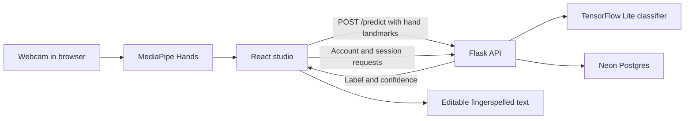

# Gesture Flow AI

An American Sign Language (ASL) fingerspelling practice app. Explore the alphabet, study recorded handshapes, and use your webcam to turn recognized signs into editable text.

---

## 🌟 Key Features

- **Studio and gesture guide** with illustrated handshapes and joint positions for A–Z and the app’s Space gesture. Each example shows a single frame from the model dataset.
- **Live Practice** with a webcam preview, hand tracking overlay, detected letter, model confidence, and editable text. The gesture guide stays alongside the camera and carries over your selected letter from the studio.
- **Light and dark modes** with a blue-and-white light theme, a saved theme preference, and controls that respect reduced-motion settings.
- **Accounts and sessions** stored in Neon Postgres.

## Using the studio

1. Create an account or sign in. Choose a letter directly in the guide or use the previous and next buttons.
2. Open **Live practice** and select **Start camera**. Grant camera permission and show one hand.
3. Hold a static sign steady until the letter appears in the text. Trace **J** down and around with your pinky, and trace **Z** with your index finger. For **Space**, hold an open palm with the fingers pointing sideways and the thumb up. Lower your hand before repeating a gesture.
4. Edit the generated text, select **Clear** to start again, or select **Speak** in browsers that support speech synthesis.

---

## 🏗️ System Architecture



---

## 📊 Model Overview

MediaPipe extracts 21 hand landmarks in the browser. Flask receives their 63 coordinates plus up to about two seconds of recent landmarks. The webcam feed stays in the browser.

The TensorFlow Lite model classifies the 24 static letters and the app's **Space** gesture after centering and scaling each hand at the wrist. **J** and **Z** use rules that match the fingertip path across multiple frames.

The static model classified all 2,629 held-out frames from the training sources correctly. These are splits by frame and may include the same signer in training and evaluation. In a separate check, the correct letter was the most frequent prediction in 53 of 62 video clips of static letters. The motion rules detected 9 of 10 J clips and 9 of 10 Z clips during development. Live webcam accuracy has yet to be measured.

---

## 📁 Repository Structure

```
hand_gesture_final/
├── backend/
│   ├── flask_app.py         # Flask API and built frontend
│   ├── auth.py              # Account and session routes
│   ├── auth_schema.sql      # Neon Postgres schema
│   ├── requirements-web.txt # Runtime dependencies for the web app
│   ├── requirements.txt     # Runtime and local ML tooling
│   └── ml/
│       ├── data/
│       │   ├── dataset/     # Raw landmark recordings, grouped by gesture
│       │   └── asl_landmarks.csv
│       ├── model/          # Trained models, label map, and training history
│       ├── analysis_outputs/
│       └── *.py            # Data collection, training, and evaluation scripts
├── frontend/
│   ├── src/                # Sign-in, studio, Live Practice, and gesture guide
│   ├── public/             # Hand illustrations and site icon
│   ├── package.json
│   ├── vercel.json         # Production frontend and API routing
│   └── vite.config.js      # Development server and API proxy
├── .env.example
├── Dockerfile
├── render.yaml
└── README.md
```

---

## 🚀 Quick Start Guide

### Prerequisites
- **Python 3.10 or 3.11**
- **Node.js 22.13+ or 24.x** & npm
- A **Neon Postgres** database
- A webcam for **Live Practice**

---

### 1. Installation

#### Backend (Python)
From the project root directory:
```bash
# Optional: create and activate virtual environment
python -m venv venv
# Windows:
.\venv\Scripts\activate
# Linux/macOS:
source venv/bin/activate

# Install the web app dependencies
python -m pip install -r backend/requirements-web.txt
```

#### Frontend (React)
```bash
cd frontend
npm ci
cd ..
```

---

### 2. Set up account storage

Copy `.env.example` to `.env` in the project root and set `DATABASE_URL` to your Neon connection string. Keep it in the Flask environment.

```bash
python -m flask --app backend.flask_app init-auth-db
```

Run this once per database. When deploying behind an HTTPS proxy, set `AUTH_COOKIE_SECURE=1` in the backend environment.

### 3. Running the Application

You need both the Flask backend and the React frontend running concurrently:

#### Terminal 1 — Start the backend from the project root
```bash
python -m backend.flask_app
```
Flask runs on `http://127.0.0.1:5000`. Vite forwards API requests to this address during development.

#### Terminal 2 — Start Frontend Application:
```bash
cd frontend
npm run dev
```
Open [http://localhost:5173/](http://localhost:5173/) and follow the studio steps above.

If signup or sign-in reports that the account database is unavailable, check the backend’s `DATABASE_URL` and run `python -m flask --app backend.flask_app init-auth-db` against that database. If the camera is blocked, allow camera access in the browser and use localhost or HTTPS.

### API routes

| Route | Purpose |
| --- | --- |
| `GET /health` | Check that Flask is running |
| `POST /api/auth/register`, `POST /api/auth/login` | Create an account or sign in |
| `GET /api/auth/me`, `POST /api/auth/logout` | Read or end the current session |
| `POST /predict` | Send `landmarks` with 63 numbers. Optionally send `motion` with up to 64 rows of timestamp in milliseconds followed by 63 coordinates. Scale the motion rows' Y coordinates by video height divided by width. A recognized J or Z includes `motion: true`. |
| `GET /get_reference?label=A` | Fetch one recorded hand pose |

---

## 🧪 Training & Custom Dataset Collection

Download `X_signalpha.npy`, `y_signalpha.npy`, `X_self.npy`, and `y_self.npy` from Ridhi Budhathoki's landmark extraction project into one directory. The first pair comes from SignAlphaSet. The second pair comes from webcam recordings. Training also uses this project's recorded Space landmarks. [Landmark arrays](https://github.com/ridhi9898/SignLanguageProject/tree/17a5b5e3c6186e5fa34d5edf44e193a33a9a82fb)

SignAlphaSet by Bindu Garg, Manisha Kasar, Achyut Kashyap, Amber Vats, Gunjan Sharma, and Aditya Hange is licensed under CC BY 4.0. This app uses normalized landmarks derived from its stills and used its videos to check J and Z recognition. [SignAlphaSet v3](https://doi.org/10.17632/8fmvr9m98w.3)

Run these commands from the project root with Python 3.11. The last two commands regenerate the reports in `backend/ml/analysis_outputs/`.

```bash
python -m pip install -r backend/requirements.txt
python -m backend.ml.train_classifier /path/to/landmark-arrays
python -m backend.ml.analyze_model /path/to/landmark-arrays
python -m backend.ml.plot_training_curve
```

Use `python -m backend.ml.collect_landmarks` to capture additional landmark examples. `python -m backend.ml.merge_dataset` exports those captures into a CSV.

---

## Deployment on Vercel, Render, and Neon

1. **Neon** — Select your database and role in the Neon console and copy its PostgreSQL connection string. Keep the SSL settings included in the URL. The role must be able to create the `gesture_auth` schema and its tables. [Neon connection guide](https://neon.com/docs/connect/connect-from-any-app)
2. **Render** — Create a Blueprint from this repository using `render.yaml`. Set `DATABASE_URL` to the Neon connection string. The Blueprint selects the Standard plan, runs the auth schema initializer before deployment, and configures `/health` as the health check. Copy the service’s assigned HTTPS origin from Render. [Render Blueprint guide](https://render.com/docs/infrastructure-as-code)
3. **Vercel** — Import the same repository and set **Root Directory** to `frontend` and **Node.js Version** to 22.x or 24.x. Set `RENDER_BACKEND_URL` to your Render service's HTTPS origin without a trailing slash in Production and in any Preview environment you plan to deploy. `frontend/vercel.json` builds the Vite frontend and proxies the auth, prediction, and gesture reference requests, so the browser uses the Vercel origin for session cookies. [Vercel configuration guide](https://vercel.com/docs/project-configuration/vercel-json)

To verify the release, open `/health` on Render. Register or sign in on the Vercel site and refresh to check that the session persists. Select a letter in the studio, open **Live practice**, and start the camera to test prediction.

## 🐳 Combined Docker Deployment

To build and run the application inside a container:

```bash
docker build -t hand-gesture-recognition .
docker run --rm --env-file .env hand-gesture-recognition python -m flask --app backend.flask_app init-auth-db
docker run --env-file .env -p 5000:7860 hand-gesture-recognition
```

---

## 🛠️ Tech Stack

| Component | Technology |
|---|---|
| **Frontend** | React 19, Vite, MediaPipe Hands JS, Axios |
| **Backend** | Python, Flask, Flask-CORS, Neon Postgres, Psycopg |
| **Machine Learning** | TensorFlow, Keras, TensorFlow Lite, NumPy, Scikit-Learn |
| **Computer Vision** | OpenCV, MediaPipe |
| **Containerization** | Docker |
